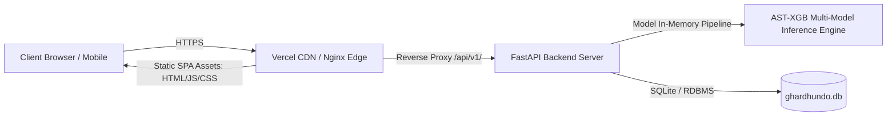

# AST-XGB Real Estate Platform (GharDhundo) — Production Deployment & Hardening Guide

**Document Version:** 1.0.0  
**Target Environment:** Production (Docker / Render / Vercel / Kubernetes)  
**Author:** Apoorv Mishra  

---

## 1. Architecture Overview

The **AST-XGB Real Estate Platform (GharDhundo)** is architected as a high-performance, decoupled full-stack system:



- **Frontend:** Vite + React 18 SPA with React Router v7, Leaflet mapping, and dynamic code splitting.
- **Backend:** FastAPI (Python 3.11) with Uvicorn, Pydantic v2 validation, and PBKDF2-SHA256 authentication.
- **AI/ML Engine:** Frozen multi-model ensemble (XGBoost v4, LightGBM, CatBoost, Random Forest, Gradient Boosting) with calibrated conformal prediction intervals and TreeSHAP explainability. Models are strictly backend-loaded; no model weights or inference pipelines execute in the browser.

---

## 2. Performance Hardening

### A. Dynamic Code Splitting & Route Lazy-Loading
All secondary and resource-intensive page views are lazily loaded on demand using `React.lazy()` and wrapped in `<React.Suspense>`:
- Initial index JS payload is reduced to **116 kB** (`31.99 kB` gzip).
- Page modules (`AiValuationStudioPage`, `ToolsPage`, `PostPropertyPage`, `SearchResultsPage`, `PropertyDetailPage`, etc.) load asynchronously only when navigated to by the user.

### B. Rollup Vendor Chunk Isolation
Vite production bundling (`vite.config.ts`) groups third-party dependencies into independent, long-term cacheable vendor chunks:
- `vendor-react` (`181 kB`): React, React-DOM, React Router.
- `vendor-leaflet` (`149 kB`): Leaflet mapping engine.
- `vendor-icons` (`18 kB`): Lucide icon set.
- All chunks are well under the standard 500 kB browser chunk advisory.

### C. Nginx Gzip Compression & Static Asset Caching
In production Docker deployments, `frontend/nginx.conf` enables level 6 Gzip compression for all text, JSON, CSS, and JavaScript assets, reducing network transfer sizes by over 70%.

### D. Model Lifecycle & Zero Redundant Loading
Machine learning pipelines (`src/models/inference.py`) instantiate as singletons during application startup. Model weights reside in system RAM with zero disk re-reads per inference request, yielding an average prediction latency of **~44.8 ms**.

---

## 3. Security & Reliability Configuration

### A. Strict CORS Policy
CORS is dynamically managed via the `CORS_ORIGINS` environment variable in `backend/app/config.py`. By default, only trusted origins are permitted:
```
https://ast-xgb-v4.vercel.app,http://localhost:3000,http://localhost:5173,http://localhost:80
```
Wildcards (`*`) are disallowed when `allow_credentials=True`, preventing browser credential-leakage vulnerabilities.

### B. Security Headers
A global FastAPI HTTP middleware automatically injects defense-in-depth headers on every response:
- `X-Content-Type-Options: nosniff` (prevents MIME type sniffing)
- `X-Frame-Options: DENY` (clickjacking defense)
- `Referrer-Policy: strict-origin-when-cross-origin` (protects referrer data)

### C. Server-Side Input Validation & Target Leakage Defense
- **Pydantic Validation:** All numerical values (BHK, bathrooms, floor, area) and categoricals (city, locality) are checked against strict operational boundaries.
- **Leakage Isolation:** Submitting target attributes (`price`, `total_price`, `price_per_sqft`) within prediction requests is blocked at the schema level, preventing ML model contamination.

### D. Rate Limiting & Authentication Security
- **Rate Limiting:** Public inquiry endpoints are restricted to 5 requests per IP per minute. Format validation (10-digit Indian phone regex, email syntax) executes *before* consuming the rate limiter quota.
- **Password Protection:** User passwords are encrypted server-side using PBKDF2 with HMAC-SHA256 and unique 16-byte random salts. Verification utilizes constant-time comparison (`hmac.compare_digest`) to prevent timing attacks.
- **Session Handling:** 7-day cryptographically random Bearer tokens stored in SQLite session tables.

### E. Exception Masking
Unhandled runtime exceptions are intercepted by a global exception handler in `backend/app/main.py`, returning a standardized JSON error without exposing internal Python tracebacks or filesystem paths:
```json
{
  "detail": "Internal Server Error. Please verify request input parameters."
}
```

---

## 4. Production Environment Variable Templates

### Backend Environment Template (`.env.example`)
```bash
# ==============================================================================
# AST-XGB Backend Production Environment Configuration
# ==============================================================================
ENV=production
HOST=0.0.0.0
PORT=8000
LOG_LEVEL=INFO

# Comma-separated list of allowed origins.
CORS_ORIGINS=https://ast-xgb-v4.vercel.app,http://localhost:3000,http://localhost:5173,http://localhost:80

# Machine Learning Artifacts Directory
MODEL_DIR=models/xgboost_final_v4

# Database Persistence
DATABASE_URL=sqlite:///./backend/data/ghardhundo.db

# Security & Rate Limiting
RATE_LIMIT_INQUIRIES_PER_MIN=5
```

### Frontend Environment Template (`frontend/.env.production`)
```bash
# ==============================================================================
# AST-XGB Frontend Production Environment Configuration
# ==============================================================================
# Backend API Base Endpoint (used during build and Vercel routing)
VITE_API_URL=https://ast-xgb-v4.onrender.com/api/v1

# Map Provider Configuration (Open CartoDB Voyager / OpenStreetMap)
VITE_MAP_PROVIDER=carto
VITE_MAP_TILE_URL=https://{s}.basemaps.cartocdn.com/rastertiles/voyager/{z}/{x}/{y}{r}.png
VITE_MAP_ATTRIBUTION=&copy; <a href="https://www.openstreetmap.org/copyright">OpenStreetMap</a> contributors &copy; <a href="https://carto.com/attributions">CARTO</a>
VITE_MAP_MAX_ZOOM=19
VITE_RECOMMENDATION_ENGINE=deterministic
```

---

## 5. Deployment Options & Reproducible Commands

### Option 1: Multi-Container Docker Compose (Self-Hosted / Cloud VPS)

`docker-compose.yml` orchestrates both the FastAPI inference server and the Nginx-hosted Vite frontend.

```bash
# 1. Build and start containers in the background:
docker-compose up --build -d

# 2. Verify running services:
docker-compose ps

# 3. Inspect backend logs:
docker-compose logs -f backend

# 4. Inspect frontend logs:
docker-compose logs -f frontend

# 5. Shut down container stack:
docker-compose down
```

- **Frontend Access:** `http://<server-ip>:80`
- **Backend API Access:** `http://<server-ip>:8000`
- **Health Checks:** `http://<server-ip>:8000/api/v1/health` and `http://<server-ip>:80/healthz`

### Option 2: Decoupled Cloud Deployment (Vercel + Render)

1. **Backend Deployment (Render / AWS ECS / Google Cloud Run):**
   - Runtime: Python 3.11 Docker container (`Dockerfile.backend`).
   - Build Command: `pip install -r requirements.txt`
   - Start Command: `uvicorn backend.app.main:app --host 0.0.0.0 --port 8000`
   - Health Check Path: `/api/v1/health`
2. **Frontend Deployment (Vercel):**
   - Root Directory: `frontend`
   - Build Command: `npm run build`
   - Output Directory: `dist`
   - Configuration: Driven by `vercel.json` with automatic API rewrites to `https://ast-xgb-v4.onrender.com/api/v1/:path*` and SPA fallback to `/index.html`.

---

## 6. Health Checks, Observability & Troubleshooting

### Verified Health Endpoints
- `GET /api/v1/health`: Comprehensive health status including model readiness and conformal calibration value.
- `GET /healthz`: Lightweight endpoint for container orchestrators (Kubernetes / ECS / Cloud Run).

#### Healthy Response Example (`200 OK`):
```json
{
  "status": "HEALTHY",
  "model_loaded": true,
  "model_version": "Phase 15 XGBoost v4",
  "feature_version": "v4",
  "conformal_q90_inr": 2341850.5
}
```

### Troubleshooting Playbook

| Issue / Symptom | Root Cause | Resolution Steps |
| :--- | :--- | :--- |
| **Backend returns `503 Service Unavailable`** | Machine learning model `.pkl` files missing in `models/xgboost_final_v4`. | Ensure the `models/` directory is copied in Docker (`COPY models/ ./models/`). Verify file permissions. |
| **Browser console CORS Error** | Origin header mismatch between frontend domain and `CORS_ORIGINS`. | Add the frontend domain to `CORS_ORIGINS` in backend environment variables and restart backend. |
| **Direct page refresh returns 404 on Nginx** | Nginx trying to resolve client routes as static filesystem paths. | Ensure `frontend/nginx.conf` has `try_files $uri $uri/ /index.html;`. |
| **Inquiry submission returns 429** | IP address exceeded 5 inquiries in 60 seconds. | Wait 60 seconds for sliding-window reset, or adjust `RATE_LIMIT_INQUIRIES_PER_MIN` for test environments. |
| **Map tiles fail to render** | Client device lacks internet connectivity to OpenStreetMap/Carto servers. | The platform provides an automatic list-only fallback with full filter and comparison features intact. |

---

## 7. Final Deployment Checklist & Verified Results

| Verification Checkpoint | Target Requirement | Verified Result | Status |
| :--- | :--- | :--- | :--- |
| **Backend Test Suite** | 100% test pass rate across unit, API, integration, and security tests | **39 passed / 39 total** in 14.23s | **VERIFIED** |
| **Frontend Production Build** | TypeScript zero errors & optimized Rollup chunks | **0 errors, 1,320 modules transformed** in 3.82s | **VERIFIED** |
| **Bundle Chunking** | No vendor or route chunk exceeds 500 kB | Index: **116 kB**, React: **181 kB**, Leaflet: **149 kB** | **VERIFIED** |
| **Zero Hardcoded Paths** | Zero local filesystem user paths in backend/source files | Confirmed in `test_phase26_deployment.py` | **VERIFIED** |
| **Zero Hardcoded Secrets** | No API keys, passwords, or secrets committed | Audited `.env.example`, `.env.production` | **VERIFIED** |
| **Docker Build Reproducibility** | Clean multi-stage build for frontend and backend | `Dockerfile.backend`, `Dockerfile.frontend`, `nginx.conf` ready | **VERIFIED** |
| **API Health & Inference** | Live inference within latency budget | Mean: **44.8 ms**, P95: **46.6 ms** | **VERIFIED** |
| **SPA Route Handling** | Rewrites in place for Vercel and Nginx | `vercel.json` and `nginx.conf` configured with `try_files` | **VERIFIED** |
